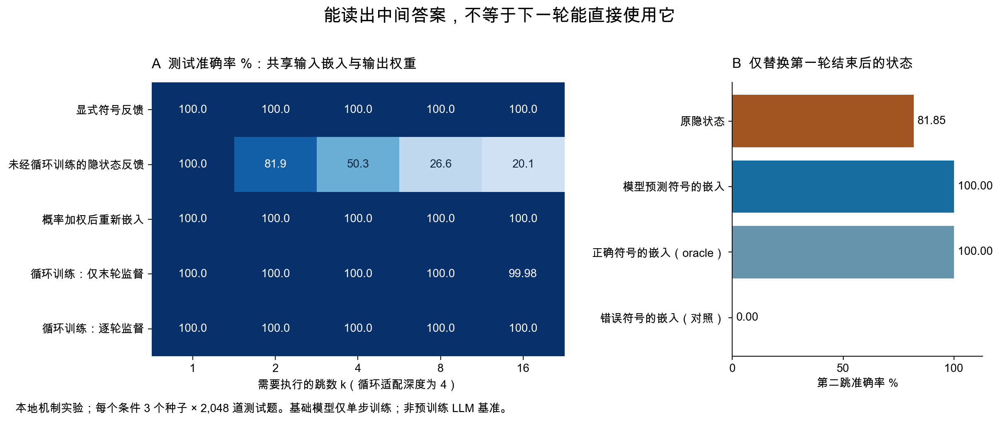
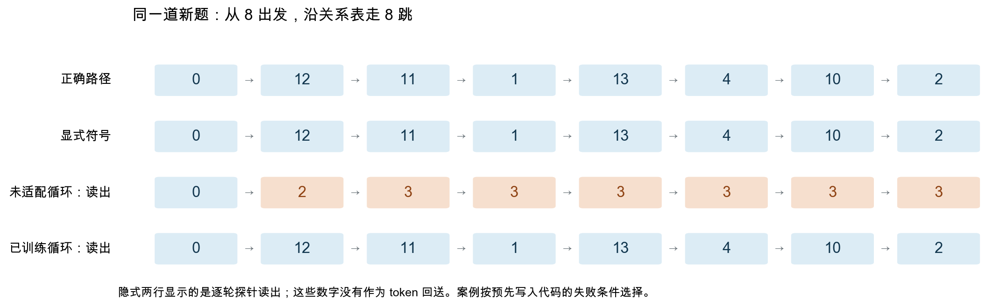
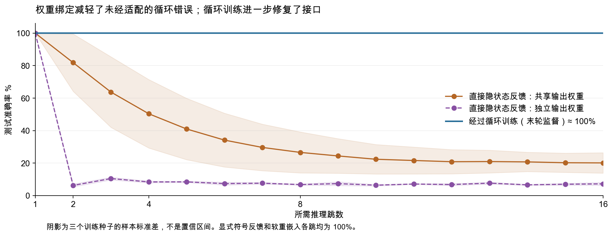

# Loop Transformer 与显式 CoT 的机制调研和运行实验

调研日期：2026 年 10 月 23 日。本文比较显式文字 CoT 与循环 Transformer 的隐式计算轨迹。

核心判断：两者都增加推理计算，但增加计算的位置、跨步传递的信息、工作记忆和训练监督不同。隐式循环可以学会与显式 CoT 相同的算法；直接把普通模型的输出隐状态接回输入，并不保证这一点。尤其要区分“中间答案可以读出来”和“下一轮真的能用它继续计算”。

这里运行的是约 2 万参数的 Transformer 式注意力机制实验，用于隔离接口问题，没有运行 Huginn、Ouro 或其他预训练大模型，也不是 DiscoLoop 的完整复现。

## 1 两条链实际在哪里不同

显式 CoT 的典型生成过程是：

\[
z_t\sim p_\theta(z_t\mid x,z_{<t}),\qquad
y\sim p_\theta(y\mid x,z_{1:T}).
\]

每步产生离散 token，随后 token 的嵌入进入后续计算；已有 token 及相应 KV cache 继续可用。注意，KV cache 仍包含连续表示，所以不能把真实 CoT 简化为“全部信息只能通过一个离散 token”。

Loop Transformer 的简化过程是：

\[
H^{r+1}=F_\theta(H^r,E(x);r),\qquad
p(y\mid x)=\mathrm{softmax}(W_oH^R).
\]

同一块参数沿深度重复使用；原输入是否每轮重新注入、是否加入循环位置、是否更新全部 token，都取决于具体架构。通常在产生一个输出 token 之前进行多轮隐式计算。它也可以继续生成显式 CoT，两种计算方式能够叠加。[Huginn](https://arxiv.org/abs/2502.05171)、[Ouro](https://arxiv.org/abs/2510.25741)

| 维度 | 显式文字 CoT | 隐式循环推理 |
|---|---|---|
| 增加计算的位置 | 序列延长，逐 token 解码 | 重复共享模块，增加有效深度 |
| 中间状态 | 可读取的离散符号，以及上下文的连续缓存 | 连续隐状态；一般没有逐轮生成的文字 |
| 中间选择 | 解码会选取一个 token，也可采样多条路径 | 不必每轮离散化，但“连续”不自动意味着有效并行搜索 |
| 工作记忆 | CoT 增长时通常增加可读取的位置 | 固定序列上的循环不会仅因轮数增加而自动增加位置 |
| 训练 | CoT 数据可对中间 token 直接监督 | 可能仅监督末轮，也可深监督、蒸馏或对齐 CoT |
| 可观察性 | 有可见轨迹，但可见解释仍需检查是否忠实 | 探针读出并非内部独立生成的 CoT，需配合干预验证 |
| 成本 | 逐 token 串行和不断增长的缓存 | 更多模块执行；参数共享不等于 FLOPs 或延迟同比下降 |

**关键接口不等式：**

\[
\arg\max W_oh=b\quad\not\Rightarrow\quad
F_\theta(h,x)=F_\theta(E(b),x).
\]

读出头只要求向量处在正确分类区域，不要求它具备下一轮查询所需的全部几何性质。即使输入输出权重绑定，也不保证二者等价。显式的 decode → embed 给下一步一个训练时经常见到的输入；连续循环必须学会直接消费上一轮产生的状态。DiscoLoop 在受控两跳知识组合实验中验证了这一类瓶颈，并提出离散嵌入与连续状态的混合通道。[DiscoLoop v2](https://arxiv.org/html/2607.00341v2)

“隐状态不能保存完整 CoT”也不是对所有循环模型成立的定理：全序列状态可以有 n×d 的工作空间，还能增设 latent slots。模拟 CoT 的理论构造明确使用额外 dummy tokens；不能把带额外空间的表达力结论解读为固定小状态可无损压缩任意长 CoT。[Saunshi 等，ICLR 2025，第 5.4 节](https://arxiv.org/html/2502.17416v1)、[关于压缩循环工作记忆的预印本](https://arxiv.org/abs/2605.30757)

## 2 本地 demo 的设计

任务：给定 16 个符号的随机置换表 f 和起点 s，预测 fᵏ(s)。这需要重复读取关系表，且有精确答案。测试 k=1…16；不同方法在同一个种子下使用完全相同的测试表与起点。

模型包含四头 cross-attention、残差连接、LayerNorm、两层 FFN、符号嵌入和输出头。每轮共享同一模块，重新读取不变的关系表，只更新查询状态。它是用于机制隔离的 Transformer 式循环块，并非标准的全序列 decoder-only LLM。

主实验绑定输入嵌入与输出权重，共 19,552 个参数；敏感性实验使用独立输出头，共 20,320 个参数。所有权重均实际训练，没有手写正确的跳转规则来替代模型推理。

| 条件 | 训练 | 推理时跨轮传递 |
|---|---|---|
| 显式符号反馈 | 单步预测 1,000 次更新 | E(argmax logits) |
| 未经适配的隐状态反馈 | 与显式条件完全相同的权重 | 原隐状态 h |
| 软重嵌入 | 与显式条件完全相同的权重 | Σ p(v\|h)E(v) |
| 循环训练，末轮监督 | 从同一基础权重再训练 1,000 次；展开 4 轮 | h；只监督第 4 轮 |
| 循环训练，逐轮监督 | 同样再训练 1,000 次；同一训练批次和优化器 | h；监督每一轮 |

三个训练种子 0、1、2；batch size 128；每种子独立生成 2,048 道测试题，共 6,144 道。基础学习率 0.002，循环适配学习率 0.0007；AdamW，梯度裁剪 1.0，CPU 两线程。循环适配使用完整的四轮反向传播。

运行后检查确认：每个种子的 256,000 张训练关系表与其测试表零重叠；两种权重设置共 30 次检查点案例回放全部重现保存的预测，案例正确路径也与关系表逐步一致。检查记录见 `verification.json`。

公平性边界：前三项只改变推理反馈接口，参数完全一致。后两项增加了训练计算；两种适配彼此匹配，不能把它们和基础模型当作等训练成本的架构竞赛。显式臂记录符号链，但下一轮只读取最新符号和关系表；任务具有 Markov 充分状态，不需要读取完整历史。因此本实验不检验 CoT 的增长工作记忆优势。

## 3 实测结果

下表为主实验准确率，单位 %，均值 ± 三个训练种子的样本标准差；不是置信区间。4 轮以外属于循环适配深度外推。

| 方法 | 1 跳 | 2 跳 | 4 跳 | 8 跳 | 16 跳 |
|---|---:|---:|---:|---:|---:|
| 显式符号反馈 | 100.00 ± 0.00 | 100.00 ± 0.00 | 100.00 ± 0.00 | 100.00 ± 0.00 | 100.00 ± 0.00 |
| 未经循环训练的隐状态反馈 | 100.00 ± 0.00 | 81.85 ± 17.66 | 50.34 ± 21.08 | 26.56 ± 12.61 | 20.10 ± 6.28 |
| 软重嵌入 | 100.00 ± 0.00 | 100.00 ± 0.00 | 100.00 ± 0.00 | 100.00 ± 0.00 | 100.00 ± 0.00 |
| 循环训练，末轮监督 | 100.00 ± 0.00 | 100.00 ± 0.00 | 100.00 ± 0.00 | 100.00 ± 0.00 | 99.98 ± 0.03 |
| 循环训练，逐轮监督 | 100.00 ± 0.00 | 100.00 ± 0.00 | 100.00 ± 0.00 | 100.00 ± 0.00 | 100.00 ± 0.00 |



在种子 0 的一个按固定失败条件选择的案例中，从 8 出发：

```text
正确路径          0 → 12 → 11 → 1 → 13 → 4 → 10 → 2
显式符号反馈      0 → 12 → 11 → 1 → 13 → 4 → 10 → 2
未经适配循环读出  0 →  2 →  3 → 3 →  3 → 3 →  3 → 3
经过训练循环读出  0 → 12 → 11 → 1 → 13 → 4 → 10 → 2
```

隐式两行的数字是逐轮读出头的诊断结果，并未回送为 token。案例按代码中的条件选择，不能用它替代总体统计。



**更直接的干预：**只在第一轮之后替换状态，其余计算和权重保持一致。原隐状态的第二跳准确率为 81.85%；换成模型自己预测的符号嵌入后为 100%；换成正确符号嵌入的 oracle 对照也是 100%；换成错误符号嵌入为 0%。正确符号来自模型预测的条件不使用测试答案。

独立输出头的敏感性实验更严重：第二跳为 6.25%，第 16 跳为 7.21%。绑定权重缓解了接口问题，但没有消除。两个设置都能通过循环适配修复。



本实验支持：单步可读的表示未必可以直接组合；重新嵌入和端到端循环训练都能修复这里的失败。它不支持“隐式推理天然更差”，也没有展示逐轮监督明显优于末轮监督——两者在这个简单任务上都接近满分，16 跳仅相差一个测试预测。需要更复杂任务才能研究两种监督的最终能力差异。

这里随 k 增长下降的是更长任务的正确率，不是“同一任务多想几轮反而变差”的 overthinking 实验。

## 4 值得重点学习的代表工作

以下按研究问题选择，不是把不同数据、参数和算力预算的论文排成统一榜单。2026 年的新工作中，DiscoLoop 和 LOTUS 按预印本证据看待。

| 工作 | 值得学什么 | 怎样降低缺陷 | 仍需注意 |
|---|---|---|---|
| [Universal Transformer，ICLR 2019](https://arxiv.org/abs/1807.03819) | 深度共享与自适应计算的基础设计 | 深度方向循环，ACT 按位置控制计算量 | 有停止机制不代表已经解决稳定训练和现代 LLM 部署 |
| [Huginn，2025](https://arxiv.org/abs/2502.05171) | 实际扩展到 3.5B 的循环语言模型 | prelude/core/coda 分工；每轮重新注入输入；稳定归一化；随机循环深度；截断反传降低训练内存 | 800B token 的实际训练项目，不是给任意模型套循环；深度外推收益依赖任务 |
| [Ouro，2025，本文参考 v5](https://arxiv.org/html/2510.25741v5) | 面向通用语言建模的训练与退出策略 | 多轮预测损失、退出分布熵正则、防止一律使用最深轮；再单独训练退出门 | 1.4B/2.6B、7.7T token；参数效率不能当作等算力优越性；曾因不稳定将 8 轮降为 4 轮 |
| [Mixture-of-Recursions，2025](https://arxiv.org/abs/2507.10524) | 推理服务中的实际效率 | 每 token 动态路由、只为活跃 token 计算和保留相应 KV；另研究跨循环 KV 共享；深度方向连续 batching | 路由、缓存和调度都要实现；论文吞吐收益依赖具体配置，不能直接换算个人电脑延迟 |
| [LoopFormer，ICLR 2026](https://arxiv.org/abs/2602.11451) | 同一模型适应不同计算预算 | 用当前时间 t 和步长 Δt 调节块；长短轨迹联合训练与 shortcut consistency | 主要验证训练预算范围内的弹性深度，不能理解为无限外推保证 |
| [RELAY，EACL 2026](https://aclanthology.org/2026.eacl-long.97/) | 把循环模型与文字 CoT 连接起来 | 让循环轮次对齐推理步骤，给予中间监督，再用生成的较长链训练自回归模型 | 依赖可获得的步骤标签与任务结构 |
| [LOTUS，2026](https://arxiv.org/html/2606.31779v2) | 缩小 latent reasoning 与显式 CoT 的能力差距 | 多个 latent blocks 并行更新，最终隐位置直接对齐 gold CoT token，同时保留答案监督 | 固定 latent 空间预算、需要 CoT 数据；“步骤—位置对齐”不同于简单“一轮一句话” |
| [DiscoLoop，2026](https://arxiv.org/html/2607.00341v2) | 最直接解释“中间答案对了但下一跳错了” | 在连续隐状态之外加入可微 soft decode→embed 通道，用门控制注入 | 添加语义锚点会带来词表投影成本；合成任务的强证据不等于所有任务通用改善 |

更具体地说，LOTUS 在 Llama-3.2-3B 的 GSM8K 设置中报告 70.0±0.9，对比显式 CoT 的 71.5；这说明它在该训练和评估设置下接近显式 CoT，而非全面超越。[原文表 1](https://arxiv.org/html/2606.31779v2)

Coconut 也值得读，但分类要分清：它主要把上一轮末隐状态作为后续序列位置的连续输入，是序列方向的 latent CoT；Loop Transformer 的核心是深度方向共享块的递归。二者有联系，不能直接作为同一架构名称互换。[Coconut](https://arxiv.org/abs/2412.06769)

## 5 缺陷对应的工程选择

**状态可读但不可用。**先做“模型预测的中间符号重新嵌入”与随机/错误符号对照，检查接口；再考虑混合连续通道和嵌入通道，或显式地对齐下一轮消费的表示。demo 的 soft arm 是纯重嵌入，DiscoLoop 则保留连续状态并叠加门控嵌入，不能把两者称为同一实现。[DiscoLoop](https://arxiv.org/html/2607.00341v2)

**长循环优化困难。**输入重注入、残差与归一化、较保守学习率和梯度裁剪是可借鉴的训练部件。截断反传能省训练内存，但会丢失部分跨轮梯度；2026-10-19 的新 scaling 预印本在其匹配计算实验中发现，较少循环配完整反传优于相同预算的截断方案。因此不能把截断反传当成没有代价的默认答案。[Huginn](https://arxiv.org/html/2502.05171v2)、[Truncate or Not? v2](https://arxiv.org/abs/2610.26030v2)

**循环次数变化后分布偏移。**训练时随机化深度，或者用 LoopFormer 式预算条件与一致性训练；测试时分别测预算内插和超出训练最大深度的外推，不能混为一谈。[LoopFormer](https://arxiv.org/html/2602.11451v1)

**所有 token 都反复计算、缓存膨胀。**用学到的退出门或 token 路由，并把活跃集合真正接入缓存和 batching 实现。权重共享只节省参数存储，循环维度的 KV 仍可能昂贵。[Ouro](https://arxiv.org/html/2510.25741v5)、[MoR](https://arxiv.org/html/2507.10524v1)

**监督稀疏、隐过程不好诊断。**RELAY 对齐轮次，LOTUS 对齐 latent 位置。应同时量化答案正确率、步骤读出与状态干预；单看 probe 准确率不足以证明模型按被读出的路径计算。[RELAY](https://aclanthology.org/2026.eacl-long.97/)、[LOTUS](https://arxiv.org/html/2606.31779v2)

**工作记忆不足。**增加 slots、保留全序列状态或引入外部 scratchpad 是增加空间；增加 loop 是增加时间。这两个预算应分开记录。相关理论比较还依赖并行状态、精度和随机化等设定，不能直接推出某种架构在所有任务上更强。[To CoT or To Loop?](https://arxiv.org/abs/2505.19245)、[Memory-Budget Separation](https://arxiv.org/abs/2605.30757)

针对“为什么两条链不同”，优先阅读 DiscoLoop → LOTUS/RELAY → Huginn；要设计完整可用的模型，再补 Ouro、MoR 和 LoopFormer。比较模型时同时报告参数、训练 FLOPs、推理 FLOPs、实际延迟、KV/状态内存与是否使用 CoT 标注。

## 6 复跑与文件

所有操作均在本目录，未改动 TRACE 的训练代码。已有隔离环境可直接运行：

```bash
cd <PROJECT_ROOT>
reports/loop_transformer_20261023/.venv/bin/python reports/loop_transformer_20261023/demo.py --tied-readout --out reports/loop_transformer_20261023/results_tied
reports/loop_transformer_20261023/.venv/bin/python reports/loop_transformer_20261023/demo.py --out reports/loop_transformer_20261023/results
python3 reports/loop_transformer_20261023/render_results.py
```

训练实测环境：Python 3.12.12、PyTorch 2.13.0、NumPy 2.4.6，macOS arm64，CPU。绘图使用系统 Python 的 Matplotlib 3.9.4、NumPy 2.0.2。可在其他环境安装兼容的 PyTorch、NumPy 和 Matplotlib 后运行；不同版本或硬件可能产生数值差异。

- `demo.py`：完整训练、评估、跨轮干预及检查点保存。
- `results_tied/results.json`：主实验配置、逐种子指标、案例概率、环境记录。
- `results/results.json`：独立输出头敏感性实验。
- `results*/seed*_*.pt`：训练好的检查点。
- `run.log`、`run_tied.log`：实际运行日志。
- `summary.csv`：每种设置、方法、跳数的均值与种子标准差。
- `verification.json`：训练测试关系表交集与检查点回放核对。
- `render_results.py`：从原始 JSON 生成图与表。
- `summary.png`、`depth_sensitivity.png`、`trajectory.png`：结果图。

本实验是解释机制的研究探针。没有测大模型自然语言质量、停止策略、真实部署吞吐、固定状态的容量极限，也没有证明内在 CoT 必须与可见文字逐步对应。
